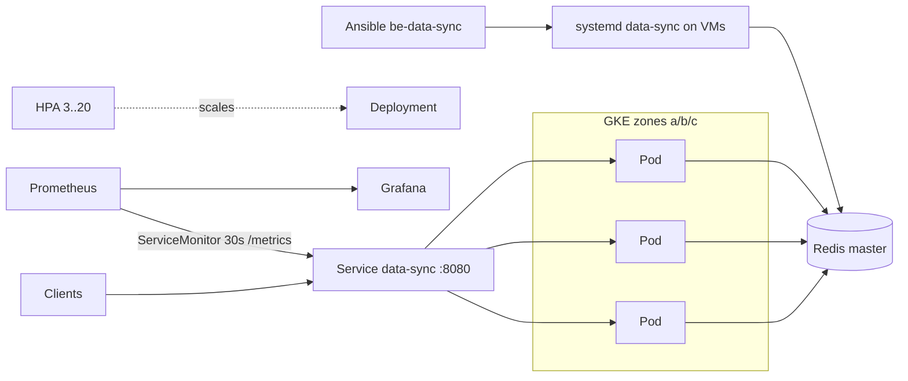

# Architecture, NFRs and repository maintenance

## 1. Architecture

* **Kubernetes path:** Helm chart (env-specific values) -> optional Kustomize overlay for workload-level patches (zone spread, secret checksum).
* **VM path:** Ansible role `be-data-sync` for services not on K8s; same env var contract (`APP_ENV`, `REDIS_*`, `LOG_LEVEL`, `WORKERS`, `MAX_CONNECTIONS`).

## 2. Non-functional requirements
| NFR | Target | How it is met |
|-----|--------|---------------|
| Availability | Survive node/zone loss and drains | min 3 replicas in prod, zone spread, PDB `minAvailable: 1`, `maxUnavailable: 0` rollouts |
| Scalability | ~2,000 req/s burst | HPA 3-20 with fast scale-up; KEDA/headroom proposed in DESIGN.md |
| Performance | stable p99 | resource requests/limits, isolation plan in DESIGN.md |
| Security | no plaintext secrets in git | Secret injected at deploy time / `existingSecret`; non-root, RO FS, dropped caps; VM secrets 0640 + vault |
| Observability | metrics, logs | `/metrics` scraped every 30 s via ServiceMonitor (`release: kube-prometheus-stack`); stdout logs to Loki |
| Operability | safe deploys, rollback | `helm --atomic`, `helm rollback`, checksum-triggered rollouts, health/startup probes |
| Maintainability | readable, linted | one chart for all envs, values overlays, `make check`, ansible-lint |

## 3. Repository layout
```
helm/charts/data-sync/        chart + values{,.staging,.production}.yaml
standard/data-sync/production/ kustomization.yaml, render.sh, secret-checksum-patch.yaml
ansible/                      roles/be-data-sync, playbooks/, group_vars/, inventory/
DESIGN.md                     Part 3 written design
docs/                         trade-offs, this document
Makefile                      lint / template / kustomize / ansible-lint
```

## 4. Maintaining the repo
* **Change config:** edit `values.<env>.yaml`; never edit templates for env differences.
* **New image:** bump `image.tag` via CI `--set`; keep `appVersion` in sync on release.
* **New environment:** add `values.<env>.yaml` (blank `redis.password`) and a Makefile lint line.
* **Secrets:** never commit passwords; rotate every 90 days per DESIGN.md section 3.
* **Before every PR:** `make check`; bump `Chart.yaml` `version` for chart changes.
* **Ansible:** keep tasks idempotent and FQCN; new variables get a default in `defaults/main.yml`; override only in `group_vars`.
* **Conventions:** `be-{service}` role names, labels via `_helpers.tpl`, comments only where behaviour is non-obvious.
